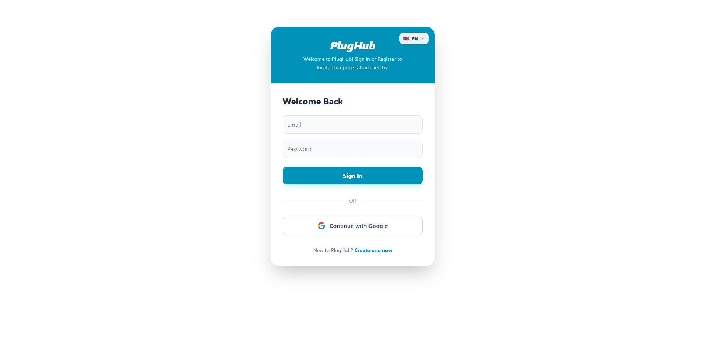
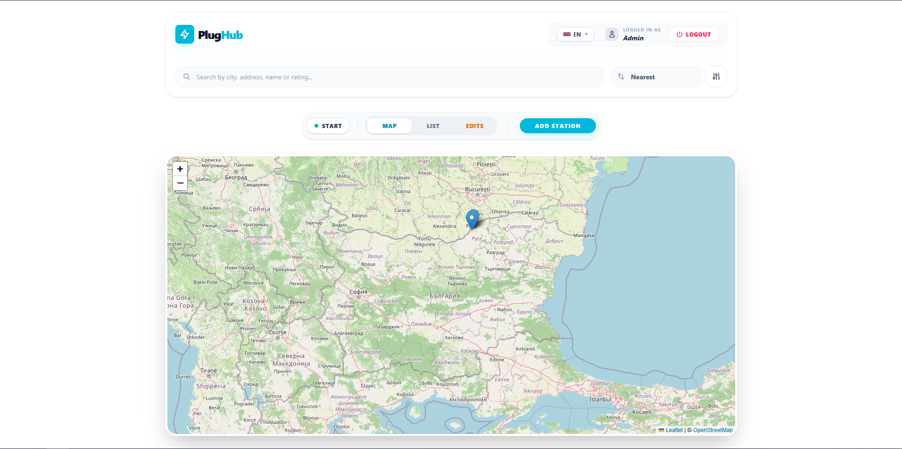
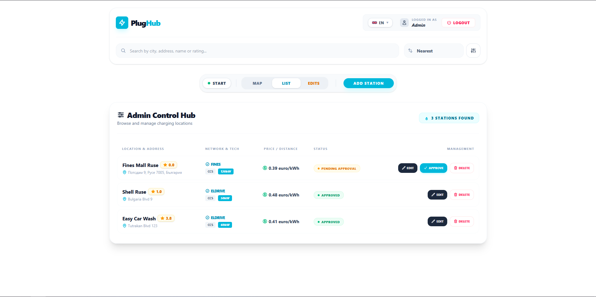

# PlugHub

PlugHub is a web application for finding electric vehicle charging stations. It was developed as my final-year diploma project at the University of Ruse “Angel Kanchev”.

## Features

- User registration and login with email/password and Google
- User profiles
- Interactive map with EV charging stations
- Charging station details
- Route calculation to selected charging stations
- Users can submit new charging stations
- Admin approval system for submitted stations
- English and Bulgarian language support
- Responsive design

## Technologies

- React
- JavaScript
- Tailwind CSS
- Supabase
- Leaflet
- Leaflet Routing Machine

## Live Demo

[PlugHub – Live Demo](https://diplomna-two.vercel.app/)

## About the Project

The main goal of PlugHub is to provide EV drivers with a simple way to find charging stations, view information about them, and get directions to a selected station.

The project was originally started using ASP.NET, but was later rebuilt with React and JavaScript as I became more interested in front-end development.

## Screenshots

<h3 align="center">Registration Form</h3>

<h3 align="center">Main Page</h3>

<h3 align="center">Admin Panel</h3>

## Development

Git and GitHub were used for version control throughout the development of the project.
